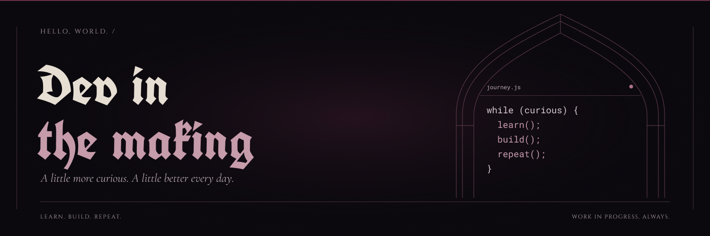

  

### 👩‍💻 Systems Analysis & Development Student 

---

<!-- ============================================= -->
<!-- ABOUT ME SECTION -->
<!-- ============================================= -->

## 🚀 About Me

<!-- [EDIT: Customize this paragraph based on your current focus] -->
> Dynamic and versatile professional, currently studying **Systems Analysis and Development at FIAP**, with solid practical experience in customer service, sales, cashiering, and operational routines. I stand out for my excellent bilingual communication, ease in learning new tools, and strong organizational skills.

- 🎓 Currently pursuing **Associate Degree in Systems Analysis and Development** at FIAP (Aug 2026 - Aug 2028)
- 💼 Working in customer service and sales at **Cinemark**
- 🌱 Currently learning: **Python, Java, Front-end Development, and AI Integration**
- 🎯 Goal: Contributing to operational efficiency and continuous process improvement
- 🌍 Languages: **Portuguese (Native)** | **English (Fluent)**

---

<!-- ============================================= -->
<!-- TECH STACK SECTION -->
<!-- ============================================= -->

## 🛠️ Tech Stack & Skills

<!-- [EDIT: Add or remove badges based on your current skills] -->

### 💻 Programming Languages

### 🌐 Frontend & Web

### 🗄️ Database & Tools

### 📊 Methodologies & Concepts

### 🎯 Other Skills

---

<!-- ============================================= -->
<!-- EDUCATION & CERTIFICATIONS -->
<!-- ============================================= -->

## 🎓 Education & Certifications

| 🏫 Institution | 📚 Program | 📅 Period |
|----------------|-----------|-----------|
| **FIAP** | Systems Analysis and Development | Aug 2026 - Aug 2028 |
| **FIAP** | Financial Management in Marketing | Certificate |
| **FIAP** | Compliance & Quality | Certificate |

---

<!-- ============================================= -->
<!-- PROFESSIONAL EXPERIENCE -->
<!-- ============================================= -->

## 💼 Professional Experience

### 🎬 Customer Service Professional | Cinemark
> Direct customer service and sales in cinema operations

- 🎟️ Cash operations, pricing, and customer support
- 🧹 Facility organization and cleaning management
- ⚡ Ensuring efficiency in daily processes

### 📞 Service Operator | UNINOVE
> Teleservice and chat support for students and academic community

- 💬 Handling administrative, academic, and financial inquiries
- 🖥️ Guiding users through institutional portals and systems
- 📝 Recording service tickets and ensuring empathetic, organized support

---

<!-- ============================================= -->
<!-- GITHUB STATS SECTION -->
<!-- ============================================= -->

## 📈 GitHub Statistics

<!-- [EDIT: These auto-update based on your GitHub activity] -->

---

<!-- ============================================= -->
<!-- CONTACT SECTION -->
<!-- ============================================= -->

## 🤝 Let's Connect!

<!-- [EDIT: Update these links with your actual profile URLs] -->

---

<!-- ============================================= -->
<!-- FOOTER -->
<!-- ============================================= -->

<!-- [EDIT: You can update the quote or remove it] -->
### 💡 "Continuous improvement is better than delayed perfection."

---

